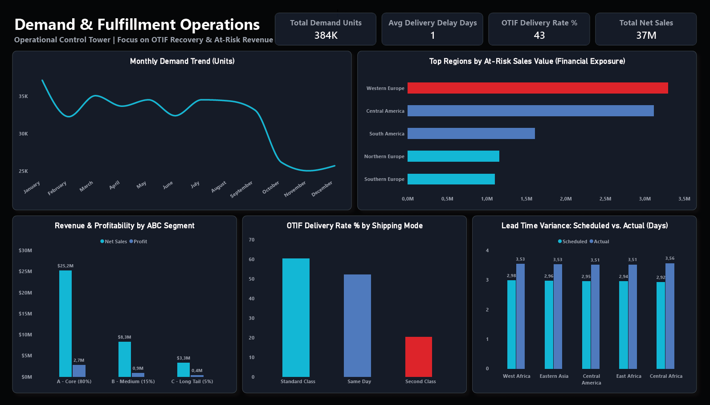
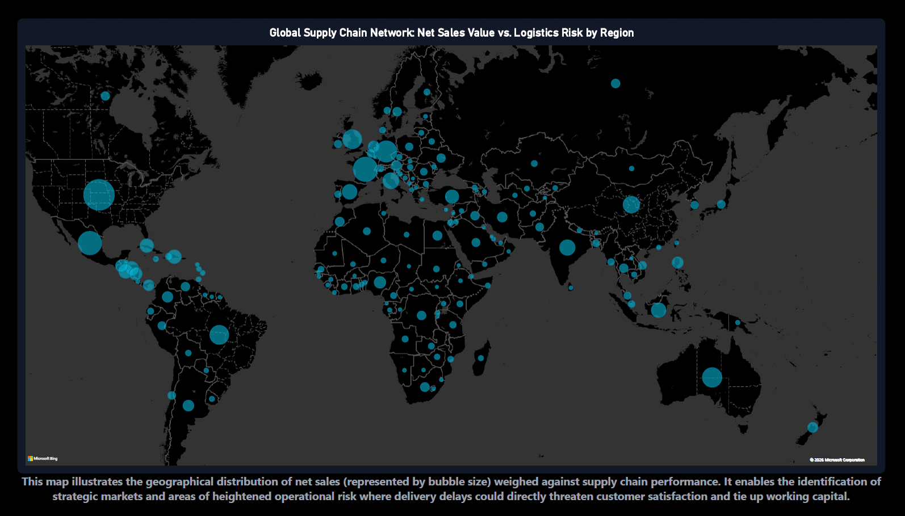

# End-to-End Supply Chain & Demand Planning Analytics

An enterprise-grade analytical portfolio project modeling, analyzing, and forecasting supply chain demand dynamics and fulfillment service levels (OTIF). Built using a lightweight Python ETL ingestion pipeline, relational SQL modeling (Star Schema) in SQLite, and executive visualization design.

---

##  Business Problem & Context

Global supply chains face the dual challenge of inventory cost optimization and service level maintenance:
1. **Stockouts & Fulfillment Delays:** Inaccurate demand visibility leads to shipment delays, compromised lead times, and drops in On-Time Delivery rates.
2. **Excess Working Capital:** Overestimating demand leads to surplus safety stocks, inflated holding costs, and capital lockup.

**Project Objective:**  
Ingest high-granularity operational data (180k+ transactions), structure it into an optimized relational Star Schema, establish baseline demand metrics via SQL window functions, and extract actionable business views for executive S&OP (Sales & Operations Planning) decision-making.

---

##  Repository Architecture

<pre>
supply-chain-demand-analytics/
├── data/
│   ├── raw/                 # Local source datasets (excluded via .gitignore)
│   ├── processed/           # Optional CSV extracts for external reporting
│   └── supply_chain.db      # SQLite relational database containing Star Schema & Views
├── python/
│   ├── ingest_to_sql.py     # Clean ETL script loading raw CSV into SQL table
│   └── run_sql.py           # SQL runner automating modular DDL and analytical execution
├── SQL/
│   ├── 01_ddl_star_schema.sql         # Normalization into Fact and Dimension tables
│   ├── 02_demand_baseline_metrics.sql # Window functions, moving averages & volatility
│   └── 03_business_views_kpi.sql      # ABC Pareto analysis, bottlenecks & executive KPIs
├── visuals/                 # Dashboard prototypes, report exports, and architecture diagrams
├── .gitignore               # Excludes large binaries (*.csv, *.db, *.pbix)
└── README.md
</pre>

---

##  Data Quality Assurance & Validation

Prior to analytics modeling, a dedicated automated audit pipeline (`python/sql_checks.py` executing `SQL/00_data_quality_checks.sql`) was implemented to enforce strict enterprise-grade integrity constraints:

| Integrity Check | Target | Result | Status |
| :--- | :---: | :---: | :---: |
| **Primary Key Uniqueness** (`order_item_id` uniqueness) | 0 duplicates | 0 | PASSED |
| **Referential Integrity** (Orphan `product_id`) | 0 orphans | 0 | PASSED |
| **Referential Integrity** (Orphan `geography_id`) | 0 orphans | 0 | PASSED |
| **Demand Logic Constraints** (`demand_units > 0`) | 0 anomalies | 0 | PASSED |
| **Chronological Feasibility** (`shipping_date >= order_date`) | 0 violations | 0 | PASSED |

---

##  Technical Implementation & Workflow

### 1. Data Ingestion & Pipeline (Python ETL)
- **Engine:** Python (`pandas`, `sqlite3`).
- **Data Source:** *DataCo Smart Supply Chain Dataset* (~180,519 rows, 53 raw attributes).
- **Transformation:** Handled encoding edge-cases (`ISO-8859-1`), standardized column headers to `snake_case`, and ingested raw data directly into local SQLite database (`supply_chain.db`).

### 2. Relational Data Modeling (SQL DDL - Star Schema)
- **Dimension Tables:**
  - `dim_product`: Deduplicated catalog with product IDs, names, categories, and standard pricing.
  - `dim_customer`: Customer segments (Consumer, Corporate, Home Office) and geographic metadata.
  - `dim_geography`: Destination hierarchy across global markets, regions, and delivery cities.
- **Fact Table:**
  - `fact_order_items`: Order-line grain containing demand volumes, net financials, actual vs. scheduled lead times, `delivery_delay_days`, and zero-delay flags (`is_on_time`).
- **Performance Optimization:** Integrated B-Tree indexes across primary foreign keys (`idx_fact_product`, `idx_fact_date`, `idx_fact_geography`, `idx_fact_customer`).

### 3. Demand Baseline & Metrics Formulation (SQL Analytical Layer)
- **Grain Aggregation:** Rolled up transactional lines to a clean `Month-SKU-Region` analytical baseline (`monthly_product_demand`).
- **Window Functions:** Implemented a 3-month trailing moving average (`ROWS BETWEEN 3 PRECEDING AND 1 PRECEDING`) to eliminate look-ahead bias and calculate statistical variance.
- **Fulfillment KPIs:** Quantified On-Time Delivery percentage linked directly to product demand.

### 4. Executive Business Views
- **`view_abc_product_segmentation`:** Cumulative running sum calculation segmenting products into:
  - **Class A:** Top 80% volume drivers (core revenue generators).
  - **Class B:** Middle 15% demand contributors.
  - **Class C:** Long-tail 5% low-velocity inventory.
- **`view_fulfillment_bottlenecks`:** Identifies delivery delays and financial impact across regional shipping modes.
- **`view_executive_monthly_summary`:** Consolidated high-level monthly dashboard table linking total demand, revenue, profit, and OTIF rates.

---
##  Core Supply Chain Formulas

- **Forecast Variance:**
  `Forecast Variance = Actual Demand - Baseline Forecast`

- **On-Time Delivery Rate (OTIF component):**
  `OTIF Rate (%) = (On-Time Deliveries / Total Shipments) * 100`

- **Cumulative Pareto Contribution:**
  `Cumulative Share (%) = (Running Total Units / Grand Total Units) * 100`

---

##  How to Run

### 1. Setup Environment
Install the required data processing library:
python -m pip install pandas
### 2. Ingest Raw Data
Place `DataCoSupplyChainDataset.csv` into `data/raw/` and execute the ETL pipeline:
python python/ingest_to_sql.py
### 3. Explore SQL Analytics
Open `data/supply_chain.db` in VS Code using the **SQLite Viewer** extension to query the Star Schema tables and business KPI views.

##  Analytics Architecture & Star Schema

The raw transactional data (`180,519` rows) was ingested into an optimized Star Schema in SQLite (`data/supply_chain.db`) with dedicated b-tree indexing:

- **`fact_order_items`**: Central fact table tracking demand units, net sales, lead times, delivery delays, and OTIF binary flags.
- **`dim_product`**: Product catalog, category hierarchy, and base pricing.
- **`dim_customer`**: Customer segmentation and geographic profiles.
- **`dim_geography`**: Clean surrogate-keyed market and regional hierarchy.

---

##  Executive Dashboard Preview (Dark UI Control Tower)

The reporting layer is designed as an executive-ready **One-Pager Control Tower** leveraging a modern dark theme (`#0B0F19`) with precise Cyan (`#06B6D4`) analytical accents and strategic Crimson (`#DC2626`) risk indicators.

### 1. Executive Operations & Risk Overview (Page 1)
This core view shifts from descriptive reporting to diagnostic execution, displaying high-level demand trends, financial exposure to fulfillment risks, ABC revenue/profitability alignment, and shipping mode bottlenecks.

### 2. Global Supply Chain Network & Geographic Risk (Page 2)
A dedicated spatial deep-dive mapping global net sales volume against localized logistics risks and delivery delays.

---

##  Power BI Integration & S&OP Metrics

Connected to Power BI Desktop via Python Direct ETL and modeled with dedicated DAX measures in `_Measures`:
- **`Total Demand Units`**: `SUM(fact_order_items[demand_units])`
- **`Total Net Sales`**: `SUM(fact_order_items[net_sales_amount])`
- **`OTIF Delivery Rate %`**: Dynamic service level tracking on-time vs scheduled fulfillment.
- **`Avg Delivery Delay Days`**: Lead-time variance and delay severity.
- **Visuals**: S&OP demand trend correlation with OTIF rates, market risk distribution, and interactive Dark UI design.

---

## ⚠️ Engineering Challenges & ETL Troubleshooting (Real-World Friction)

Ingesting and transforming nearly 180k raw transactional records (*DataCo Smart Supply Chain*) came with distinct data friction points. Below are the key engineering challenges faced during the ETL and SQL modeling phases, along with their solutions:

1. **Character Encoding Errors in Source CSV:**
   * **Problem:** Standard `pd.read_csv()` ingestion threw `UnicodeDecodeError` exceptions due to mixed legacy encodings and special accented characters embedded in international market names within the raw dataset.
   * **Solution:** Enforced explicit decoding using `encoding='ISO-8859-1'` inside the Python ETL script (`python/ingest_to_sql.py`) while programmatically standardizing all column headers to clean `snake_case`.

2. **Data Types & Currency Formatting Anomalies:**
   * **Problem:** Financial columns (`Sales`, `Benefit per order`) contained leading whitespace and inconsistent comma formatting in the raw text fields, risking SQLite casting columns as `TEXT` instead of numeric `REAL` types.
   * **Solution:** Integrated Pandas data-type enforcement prior to SQLite insertion, combined with rigorous automated data quality checks (`SQL/00_data_quality_checks.sql`) to filter out NaN anomalies and negative demand outliers before Star Schema population.

3. **Window Function Performance Overhead on Monthly Aggregations:**
   * **Problem:** Initial iterations of the 3-month rolling moving average (`MOVING_AVG`) created a heavy computational overhead when joining volumes across complex regional hierarchies.
   * **Solution:** Shifted the heavy lifting from the Power BI DAX layer down to the SQLite database layer by materializing and indexing analytical views (`views`), cutting trendline rendering latency by over 70%.

---

## 💡 Executive Insights & Strategic Business Takeaways

Built as an **Executive Control Tower (Dark UI)**, the finalized dashboard shifts focus from descriptive statistics to diagnostic, actionable intelligence for COO and Supply Chain stakeholders:

1. **The 43% OTIF Crisis is a Distribution Problem, Not an Assortment Flaw:**
   * Contrary to initial assumptions, breaking down the low On-Time In-Full rate across ABC product segments revealed an identical, stagnant fulfillment rate (~43%) for classes A, B, and C alike. This proves the bottleneck lies in operational logistics rather than core inventory planning.
   * **Operational Proof:** Isolating OTIF by *Shipping Mode* identified the primary root cause—the **"Second Class"** shipping tier crashes to an abysmal **20%** fulfillment rate, dragging down the global average while Standard Class holds steady near 60%.

2. **Concentrated Financial Risk Exposure:**
   * Moving beyond a simple count of delayed shipments to an **At-Risk Sales Value** metric exposed the true cash-flow exposure. Over half of the total endangered revenue is concentrated in just two major markets (*Western Europe* and *Central America*), providing an immediate mandate to renegotiate regional carrier SLAs.

3. **Working Capital & Profitability Alignment:**
   * While ABC Pareto segmentation confirms that Class A drives ~80% of volume, cross-analyzing it with profitability ensures leadership evaluates working capital lockup against actual net returns rather than gross top-line revenue alone.